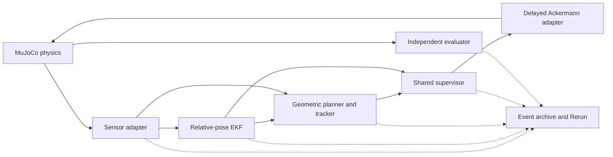

# Shared runtime and implementation contract

## Purpose and design status

This document defines the runtime used by the geometric pallet-engagement stack. The `geometric` method plans a joined approach and insertion path and tracks it with pure pursuit. It is the default method. The stationary `hold` method exercises sensing, estimation, supervision, scoring, and recording without autonomous travel.

The runtime retains the selected method through completion or failure. Repeated episodes use seeded scenario and disturbance streams. The scene contains an empty floor and one stationary pallet. Retreat belongs to recovery. The [geometric design](DESIGN_GEOMETRIC.md) describes the controller and measured results. The [recovery guide](RECOVERY.md) identifies the archived alternative methods and pre-cleanup working state.

## Requirements and chosen scope

The requirements reference is *The Last Two Meters - Intent Robotics*, assignment items 01-09 on pp. 2-3. The local source is [the brief](</home/amir/Downloads/The Last Two Meters - Intent Robotics.pdf>). Its suggested numbers on p. 3 are tunable. Its evidence list appears on pp. 3-4.

| Assignment reference | Shared responsibility |
|---|---|
| P. 2, item 01 | Rear-steered plant, measured motion limits, and actuation delay |
| P. 2, item 02 | Range-dependent detector noise, limited captures, random dropouts, and odometry drift |
| P. 2, item 03 | Timestamped relative-pose estimator |
| P. 2, item 04 | Selected method and shared vehicle geometry |
| P. 2, item 05 | Supervisor, recovery authorization, retry budget, and abort behavior |
| P. 2, item 06 | Independent physical evaluator |
| P. 2, item 07 | Seeded batch runner and failure breakdown |
| P. 2, item 08 | A paired robustness experiment |
| P. 3, item 09 | Simulator-independent messages and component interfaces |

The scene uses NVIDIA ForkliftC and the black SimReady rackable pallet. Fork height and spacing are fixed and suitable for the selected entry face. The pallet is stationary. Surrounding floor is empty. These are engineering scope choices under the one-day constraint on p. 3.

Item 05 explicitly names approach, align, and insert sequencing. The geometric method enforces their physical order through execution conditions and record progress through the same regions. The geometric method joins its approach and straight insertion segments with a continuous speed profile. Its join and face-crossing events mark progress. This interpretation of item 05 needs an explicit explanation in the final architecture note.

## Episode configuration and method selection

One resolved episode configuration contains the scenario, method, geometry, sensor settings, actuator settings, estimator settings, supervisor settings, and evaluator thresholds. Method-specific settings occupy a separate section. A run manifest stores the resolved values.

The package is `pallet_engagement`. The CLI defaults to geometric motion generation.

```sh
python -m pallet_engagement run --method geometric --scenario nominal --seed 7 --record
python -m pallet_engagement evaluate --methods geometric --suite comparison --seeds 0:50
```

The README includes engagement, hold, batch, probe, and replay commands.

The registry loads the selected method lazily. The runtime pins its dependencies in `requirements.txt`.

Suggested scenario values include 2-4 m initial fork-tip distance, lateral offsets through 0.5 m, and heading errors through 20 degrees. The distance is measured along the pallet axis. Those definitions make rotated-pallet comparisons consistent. These starting ranges follow p. 3's suggested numbers.

## Frames, geometry, and motion model

Use metres, seconds, and radians internally. Place the body frame at the fixed front axle midpoint. Its x-axis points forward and its y-axis points left. Positive yaw is counterclockwise. Place the pallet frame at the entry-face center with x pointing into the pockets and y toward the labeled left opening.

Calibrate the axle-to-tip transform and both opening-center offsets from the active scene. Pocket labels remain attached to pallet sides throughout an episode. The nominal 23.5 mm side clearance in the older draft requires a geometry check. The 20 mm and 25 mm probes establish a tested interval at zero yaw.

The common planar prediction uses front-axle speed `v`, equivalent central rear angle `delta`, and wheelbase `L`.

```text
dx/dt = v cos(psi)
dy/dt = v sin(psi)
dpsi/dt = v kappa
kappa = -tan(delta) / L
```

The adapter and predictors share the Ackermann conversion. For rear lateral coordinate `y_rear`, front lateral coordinate `y_front`, and wheel radius `r`,

```text
delta_rear = atan2(-L kappa, 1 - kappa y_rear)
omega_front = v (1 - kappa y_front) / r
```

Current probe values are `L = 1.652 m`, rear coordinates `+/-0.570 m`, front coordinates `+/-0.522 m`, and `r = 0.325 m`. Positive curvature produces a forward left turn with rear wheels steered right.

The prediction model includes the configured command FIFO and target slew limits. The tracking predictor approximates measured speed and steering response with calibrated first-order response times. Its state is `[x, y, psi, v, delta]`, and its inputs are requested speed and curvature. Per-wheel limits are evaluated through the Ackermann conversion. Asymmetric measured steering contributes to prediction error and the tracking allowance.

The controller reconstructs its queue from issued commands and configured nominal delay. The simulator owns actual application. Hidden delay variation uses configured uncertainty bounds in the guard. Its exact sampled value stays in the plant and evaluator. The default fixed-delay episode makes the modeled and applied queues coincide.

Response times, braking bounds, and tracking allowances come from isolated actuator checks before closed-loop evaluation. Limiting a steering target alone establishes a requested rate. The plant acceptance check also measures actual wheel angle rates and speed. This distinction matters for assignment item 01 on p. 2.

## Messages and ownership

Messages are immutable snapshots with a schema version, episode identifier, sequence number, acquisition time, and explicit frame identifiers where applicable. Arrays are copied when recorded or handed to another process.

| Message | Contents |
|---|---|
| `VehicleFeedback` | Timestamp, encoder positions, measured wheel speeds, both rear angles, and estimated axle speed |
| `OdometryIncrement` | Start and end times, planar translation in the previous body frame, yaw increment, and motion covariance |
| `PocketObservation` | Capture time, labeled entrance pair in the body frame, and shared face-pose covariance |
| `Estimate` | State time, relative pallet pose, covariance, last accepted detection time, and initialization status |
| `ControlContext` | Estimate, feedback, target geometry, limits, pending commands, recovery authorization, and simulation time |
| `MotionProposal` | Requested speed and curvature, issue time, validity deadline, status, and method diagnostics |
| `GuideTrajectory` | Plan identifier, target identifier, source time, sampled path, direction, and speed profile |
| `SupervisorDecision` | Released command, override reason, recovery authorization, and attempt count |
| `EpisodeOutcome` | Physical success, first contact, terminal errors, terminal reason, and recording completeness |

The method interface has `reset`, `observe`, and `propose` operations. `reset` clears episode state and history. `observe` accepts timestamped updates. `propose` consumes a `ControlContext` and returns a `MotionProposal`. A proposal can request a hold, replan, retry, or completion assessment. The supervisor decides execution permission.



Sensor generation and evaluation read true world poses. The selected method and estimator consume the declared messages and fixed geometry. This boundary addresses p. 3, item 09.

## Sensor generation

At each 5 Hz capture, perturb the face pose in body coordinates and transform both calibrated landmarks through that pose. Position standard deviation interpolates linearly from 0.01 m at zero range to 0.03 m at 4 m. Yaw standard deviation interpolates from 1 to 2 degrees over the same range. Clamp the interpolation outside those endpoints.

One Bernoulli draw discards the whole observation with probability 0.10. Generate pose noise on every scheduled capture, including discarded captures. Separate random streams cover detector noise, dropout draws, and odometry drift. A scripted consecutive outage is a separate disturbance setting.

Odometry derives travelled distance from both measured front encoder increments. It derives curvature from the measured rear angles through inverse Ackermann geometry. For each rear wheel,

```text
kappa_i = -tan(delta_i) / (L - y_i tan(delta_i))
```

A symmetric average supplies the first curvature estimate. Measured disagreement is logged. Integrate constant curvature over the interval to obtain body-frame translation and yaw. Near zero curvature, use the straight-motion limit.

The sensor model adds distance-scale bias and heading bias per metre travelled. Their biases evolve with seeded random walks whose increments scale with the square root of elapsed time. It then adds measurement noise. The odometry message covariance describes the configured increment error model. The estimator's process allowance covers residual accumulated drift.

These mechanisms answer item 02 on p. 2. Capture rate, detector noise, and dropout probability follow p. 3's suggested values. Bias strengths are engineering choices recorded with units in configuration.

## Estimation and time synchronization

The EKF state is `[p_x, p_y, phi]`, the stationary pallet pose in the current body frame. Initialize from a valid detection while stopped. Given odometry translation `d` in the previous body frame and yaw increment `a`, predict

```text
p_pred = R(-a) (p - d)
phi_pred = wrap(phi - a)
P_pred = F P F^T + G Sigma_odom G^T + Q_drift
```

The state Jacobian has `R(-a)` in its upper-left block and `1` in its yaw entry. The odometry Jacobian has `-R(-a)` in its translation block, `[p_pred_y, -p_pred_x]` in its yaw column, and `-1` in its final entry.

Recover a face-pose observation from the labeled landmark pair. Its measurement function is the identity. Wrap the yaw innovation, apply one correction per capture, and use the Joseph covariance update. The three-state model represents persistent bias through process uncertainty. Evaluation checks its error coverage during outages. These choices implement item 03 on p. 2.

All simulation messages use integer physics-step time converted to nanoseconds. The physics step is 2 ms. Odometry endpoints occur every 10 steps and detector captures every 100 steps. At a shared timestamp, propagate odometry to that time before applying the detection. Each sequence number is consumed once.

The first version delivers surviving detections at capture time. Future-dated messages wait for their acquisition time. Out-of-order detections are rejected and counted. Delayed sensing requires a later buffered rewind-and-replay extension. Immediate delivery is a documented simplification, separate from the required actuation delay.

An estimate carries its own state time and last accepted detection time. A dropout advances the state time through odometry while retaining the last accepted capture time.

## Scheduling and command application

| Operation | Initial rate or setting | Basis |
|---|---|---|
| Physics and contact scoring | 500 Hz | Existing scene and engineering choice |
| Odometry, estimator prediction, and supervisor | 50 Hz | Engineering choice |
| Detector captures | 5 Hz | Brief p. 3 suggestion |
| Geometric tracker | 50 Hz | Engineering choice |
| Command delay | 150 ms | Within brief p. 3's 100-200 ms suggestion |
| Per-wheel steering rate | 30 degrees per second | Brief p. 3 suggestion |
| Engagement speed cap | 0.45 m/s | Engineering choice below the p. 3 suggestion |
| Recovery speed cap | 0.10 m/s | Engineering choice |
| Detection freshness threshold | 0.60 s | Engineering choice |
| Standstill | Speed below 0.01 m/s and yaw rate below 0.01 rad/s for 0.20 s | Engineering choice |
| Acquisition timeout, episode timeout, retry budget | 3 s, 60 s, one retry | Engineering choices |

At each control timestamp, the runtime advances the estimator, consumes a due proposal, applies supervision, and enqueues the released command. The adapter applies each command at its issue time plus delay. A 150 ms delay is 75 physics steps. Target slew limits run at physics rate. Measured motion feeds the next sensor updates.

The common supervisor checks every proposal and each interval between proposals. On rejection, it enqueues a braking command and records the reason. Existing FIFO entries remain part of the predicted stop. Direction changes require measured standstill.

The runtime has two explicit execution modes.

- `deterministic` pauses simulation time during computation. The geometric planner tests a finite set of curves and withdrawals. It measures wall time separately. Outcomes describe idealized compute availability.
- `realtime` advances on wall-clock deadlines. Motion generation runs in a worker, while estimation and supervision remain responsive. Late results expire, and the runtime executes a previously checked stopping continuation.

Every result names its execution mode. Exact seeded replay is assessed in deterministic mode. Realtime evaluation reports scheduling and solver latency distributions. The two result sets carry separate summaries.

Worker results include episode, target, and configuration identifiers. Target identity refers to the selected pallet face and goal definition. A normal estimator correction updates the estimate revision. The runtime rechecks the returned path from the latest pose and command history before activation. Reset, abort, and recovery changes invalidate outstanding work.

## Clearance, supervision, and completion

The shared supervisor owns acquisition, motion authorization, holds, recovery authorization, abort, and completion assessment. Each method owns its proposed driving behavior. Geometric joins, face crossings, and method progress indicators are recorded as diagnostics. Healthy forward motion continues through segment boundaries. Safety failures, recovery, and final completion can require a stop.

Model the pallet's occupied solids and the forklift's separate collision pieces at relevant heights. Check fork entry through the actual free pocket corridors. Sweep the counterweight and carriage as well as the forks.

For each boundary, use nominal clearance `c`, pose sensitivity `J`, and propagated pose covariance `P`. Transform covariance through the inverse-pose Jacobian when expressing the EKF state in pallet coordinates. Keep each sensitivity and covariance in matching coordinates.

```text
available_clearance = c - k_sigma sqrt(J P J^T) - tracking_allowance
```

Start with `k_sigma = 2`. This is an approximate engineering margin. Validate it against true fork error and nonzero-yaw probes. At 600 mm depth, a 2 degree heading error alone produces about 21 mm lateral displacement.

The guard rolls out pending commands, the candidate's next command interval, and a braking continuation. It checks intermediate states with spatial sampling bounded relative to the smallest clearance. Refinement includes the maximum corner motion caused by rotation. An inconclusive geometric check causes a hold.

The scalar stopping estimate is `abs(v) tau + v^2 / (2 a_brake) + buffer`. The geometric stop rollout also accounts for heading changes and steering lag. Bounds must cover observed braking performance before entry tests.

Before entry, a forward method can use an uncertain distant guide while its nominal geometry is clear and the uncertainty-adjusted face distance exceeds 1.5 times delayed stopping distance plus the 25 mm buffer. The supervisor checks the actual stopping sweep independently. The geometric controller limits local progress to preserve this reserve. Stale sensing permits this bounded approach until the detection-loss abort deadline.

An entry decision checks the complete intended pocket traversal, including uncertainty, while the vehicle approaches the face. Geometric tracking supplies the straight remainder of its joined trajectory and a prediction of the next request. The check returns clearance and permission. The geometric tracker supplies every driving command. Until entry is permitted, the guard preserves the ability to stop outside the uncertainty-adjusted face.

During entry, the guard checks the remaining corridor and stopping motion. A poor late angle leads to a stop and recovery request. Hidden actuation variation expands the stopping envelope using the configured delay and response bounds.

The evaluated minimum depth is 0.60 m. A commanded terminal depth includes an allowance for depth uncertainty and stopping error, constrained by the measured available pocket depth. The allowance is selected during geometry and actuator verification.

Checking a retreat and its forward continuation before moving is our recovery choice under p. 2, item 05. Empty surroundings remove rear-obstacle mapping from the scene. Withdrawal still needs pallet clearance. Recovery uses a signed retreat, a full stop, reacquisition, and a new proposal. The selected method supplies the retreat command sequence.

## Independent evaluator and comparison

The evaluator checks forklift-pallet contact at every physics step, including descendant bodies. A pair with signed separation at or below zero counts as contact. Positive-separation proximity records retain their distance without triggering the contact outcome. Expected floor contacts are classified separately. First contact is latched and takes precedence over later recovery.

Success requires a settled stop with all four corners of each fork tip face at least 0.60 m inside the true pallet frame. Tip-midpoint lateral error must be below 30 mm and absolute relative yaw below 2 degrees. Both forks must lie inside their pocket volumes. The error thresholds follow p. 3's suggestions. Depth, corner measurement, and settling conditions are engineering choices under item 06 on p. 2.

Record the terminal reason and all earlier interventions. Reasons include contact, acquisition timeout, expired proposal, planning failure, uncertainty abort, retry exhaustion, episode timeout, and terminal pose error. A planner rejection establishes failure within the explored candidate set and budget.

A comparison suite stores explicit scenario poses and disturbance streams independently of method randomness. Start with 50 matched scenarios per disturbance level. Seed streams are keyed by scenario and sensor tick, so differing episode lengths preserve matching samples at shared times.

Report success counts with denominators, confidence intervals, failure counts, contact depths, terminal errors, completion time, retries, overrides, and wall-clock computation. Method rates and execution modes accompany every comparison. This addresses item 07 on p. 2.

For item 08, increase consecutive missed detections starting at a preregistered capture index for each scenario. Compare geometric tracking's standard behavior with a speed cap that decreases as projected uncertainty consumes clearance. Use matched scenarios and capture indices. Record distance to the pallet at outage onset because methods reach different positions at the same time. Report the limits for success, controlled abort, and contact separately. The initial study uses one common intervention so comparisons isolate its effect.

## Recording and visualization

Use Python component interfaces and bounded queues. Rerun provides live telemetry visualization and saved `.rrd` recordings. MuJoCo provides the native scene viewer and offscreen video rendering. The integration pins SDK and viewer versions together. Rerun's recording facilities are described in its [official documentation](https://rerun.io/docs/getting-started/data-in).

Each recorded episode produces the following local artifacts.

| Artifact | Contents |
|---|---|
| `manifest.json` | Resolved configuration, method, seeds, source revision, dirty-tree flag, dependency versions, and execution mode |
| `events.jsonl` | Timestamped sensor messages, estimates, proposals, released commands, applied targets, contacts, and decisions |
| `states.npz` | Copied MuJoCo pose snapshots for scene playback at recorded sample times |
| `trace.rrd` | Synchronized diagnostic views derived from the recorded signals |
| `outcome.json` | Physical metrics, terminal reason, timing statistics, and recording status |

The event archive supports estimator replay and analysis. Rerun handles visualization. Pose snapshots support scene playback and video export. Exact physics resumption would require additional integrator, actuator, runtime, queue, and random-generator state.

Use one simulation timeline and a separate wall-clock timeline. Show truth and estimate, detected pockets, active guide, predicted trajectory, fork clearance, covariance terms, detection age, requested and measured motion, solver status, and supervisor decisions. Truth is clearly labeled evaluator data.

Logging copies data into a bounded writer queue. Disk writing and video encoding run outside control computation. Recording overflow is counted and invalidates evidence completeness. Display frames can be sampled independently. Headless batches can produce numeric traces without rendering every episode.

## Evidence and implementation sessions

The finished system's evidence follows the brief's list on pp. 3-4.

| Requested evidence | Planned source |
|---|---|
| Repository history and one-command result | Existing history and the README install-and-run command |
| Architecture note with interfaces and rates | This contract and the selected method document |
| Success rates, failure modes, and robustness plots | Shared evaluator and paired batch runner |
| One success and one failure recording | Recorded state playback and rendered videos |
| Three debugging failures with plots and causes | Actual development traces with experiment identifiers |
| Limitations | Recorded simplifications, measured failures, timing assumptions, and unverified hardware behavior |
| First-week hardware answer | Half-page commissioning sequence covering interfaces, calibration, low-speed validation, sensing, and recovery |

Evidence generation remains local. Publication and external delivery require a separate user request.

The runtime supplies message schemas, sensor timing, actuator queues, the EKF, geometry checks, the evaluator, recording, and method registration. The geometric method supplies the closed loop and validates the common geometry and braking model. A stationary hold method isolates runtime diagnostics. Changes and measured limitations belong in this contract or the geometric design.

## Shared acceptance evidence

The shared layer is ready for method integration when the following evidence exists.

- Zero-noise observations recover translated and rotated pallet poses with the declared frame conventions.
- Scheduled captures, random dropouts, and odometry drift replay from the same seeds.
- A 100 percent dropout case advances estimate time while retaining the last accepted detection time.
- Stationary acquisition under nominal detector noise produces a usable entry margin within the acquisition budget. Error coverage and rejected gates are recorded before planner tuning.
- A step command first applies at the configured delay. Measured angle rates, speed, and braking satisfy the declared plant limits.
- The contact evaluator detects both offset directions and preserves the existing probe checks.
- Rotated-pallet depth uses the pallet axis. First contact remains a failure after recovery.
- Method selection changes motion generation while retaining the same scenario, sensors, supervisor, and evaluator configuration.
- A recorded episode reopens in Rerun, replays through the estimator, and supplies a scene playback.
- Realtime runs report missed deadlines and include the delayed braking continuation in each safety decision.

## Shared implementation and measured evidence

The hardware-facing interface lives in `pallet_engagement/messages.py`. A method implements `reset`, `observe`, and `propose`, declares its period in nanoseconds, and supplies a factory through `methods.REGISTRY`. The runtime delivers feedback, odometry, surviving captures, and estimates in order. At each supervisor tick it supplies a `ControlContext` with nominal pending commands and issued history over the configured delay bound. A distinct derived method seed is available in the reset settings. Only the simulator and evaluator read the physical poses and sampled plant delay.

`MotionProposal.status` accepts `drive`, `hold`, `replan`, `retry`, `reacquire`, `failed`, and `complete`. Hold and replan request zero speed. A retry requires a clear signed guide in the pallet frame with a stopped transition and a forward continuation. Reverse proposals identify that guide. For completion, the supervisor checks estimated tip depth, lateral error, yaw, clearance, and standstill before requesting physical assessment. The guard checks issued commands through braking even when it rejects the candidate. These interfaces support assignment items 04 and 05 on p. 2 and item 09 on p. 3.

The runtime samples position and yaw noise at each capture, including missed captures. Sensor, dropout, odometry, scenario, and delay streams have separate seeds. An odometry update covers its explicit start and end times. At a common timestamp the EKF consumes odometry before the capture. Realtime workers receive the observations accumulated since their previous job. A method period that falls between 50 Hz control ticks is serviced on the next tick. Realtime results include worker latency and control lateness. The process boundary protects the estimator from long-running method calls. The host provides best-effort scheduling. These choices address items 02 and 03 on p. 2.

The following results come from `python -m unittest discover -s tests -v` with the pinned dependencies.

| Check | Observed result |
|---|---|
| Target application and braking, p. 2, item 01 | The first request applies after 75 physics steps. A 0.45 m/s turning request followed by braking reached 0.440 m/s and 20.81°/s measured peak wheel rate. The stop path measured 0.272 m against a 0.430 m bound. |
| Stationary acquisition, p. 2, items 02 and 03 | Seed 7, 30 mm before entry, produced a 1.46 mm full-traversal margin in 1.80 s. The test uses nominal noise, random dropouts, and odometry drift. |
| Pocket geometry and contact, p. 2, item 06 | The active scene gives 22.64 mm nominal outer blade clearance. The pocket landmark lies about 219.4 mm from the centerline. Each fork center lies 293.25 mm from it. |
| Settled physical assessment, p. 2, item 06 | Scripted centered and ±20 mm starts on a pallet rotated 0.47 rad settled at 678 mm minimum depth. Both ±25 mm starts latched first contact at 63 mm. The latch persisted through withdrawal. A 0.075 rad heading error also produced contact. |
| Replay and scheduling, pp. 3–4, evidence items 02 and 04 | Estimator replay compares every archived estimate, covariance, state time, and last accepted capture. A 120 ms test method expires while the 50 Hz control loop continues. |

The adapter overrides the compiled scene's drive gain and steering damping. With the original damping, a 16°/s steering target ramp produced a 101.5°/s measured wheel rate in the turning check. The shared runtime uses drive gain 800, steering damping 3000, and a 0.44 m/s target ceiling for a 0.45 m/s measured limit. A rolling turn and brake sequence gave first-order response fits of 0.104 s for speed and 0.907–0.930 s for rear angles. `prediction.advance` uses rounded values of 0.105 s and 0.92 s. The supervisor uses a conservative braking rate of 0.30 m/s². Runtime scoring monitors true axle speed and measured steering rates at 500 Hz. The original XML and probe retain their original tuning.

The guard uses separate projected rectangles for the collision pieces. It clips fork blades at the uncertain entry plane and treats the non-fork pallet envelope conservatively across heights. It reserves 2 mm for tracking and projects two standard deviations of pose uncertainty. It checks the supplied guide and tracking prediction. A full guide ending at a stopped engagement pose supplies the entry continuation after validation. Other proposals use a straight full-depth continuation on entry. The delayed braking sweep applies to every proposal. The physical evaluator uses the actual contact pairs, three-dimensional blade boxes, and pallet frame. The 25 mm commanded depth allowance is an initial tuning value for the 600 mm evaluated threshold. The scripted runs validate the score and bracket clearance at zero yaw. Closed-loop tracking error, braking bounds across maneuvers, and the allowance still need method-level validation.

For item 07 on p. 2, the batch runner reports matched scenarios, denominators, failures, and timing. For item 08, it supports prescribed consecutive outages and a paired clearance-dependent speed cap. The geometric report records the outage study and successful and failed engagements.

The three-second nominal hold recording for seed 7 had zero rejected updates. All three estimated coordinates were simultaneously within their marginal two-standard-deviation bands at 70 of 151 ticks. During the 30 ticks at least one capture period past the last detection, 10 met that condition. These samples share a trajectory and measurement history. Calibrating uncertainty coverage across independent moving episodes remains part of method validation.
