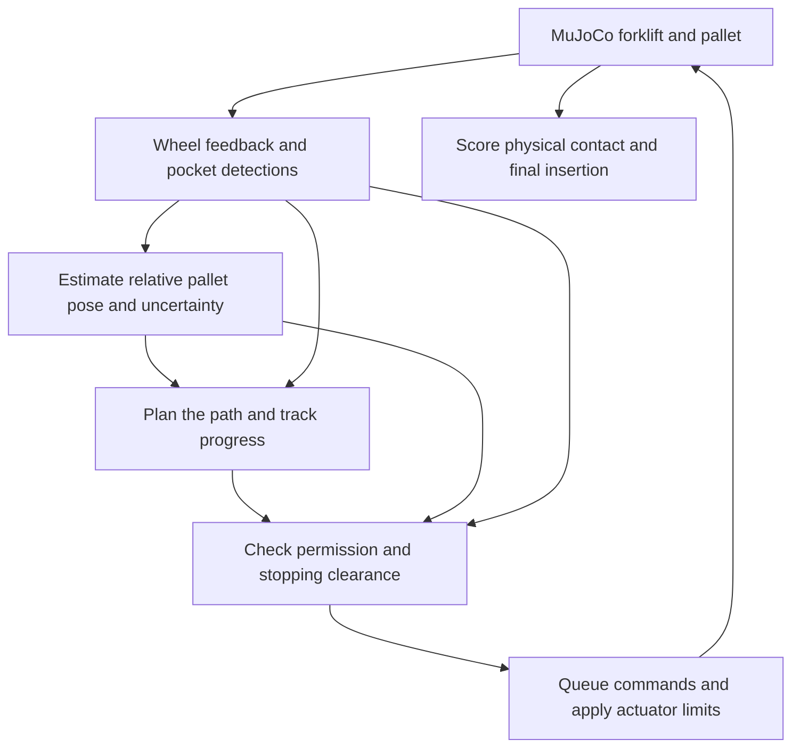

# How the pallet-engagement pipeline works

This document explains how the forklift finds a pallet, approaches it, and inserts both forks into their pockets. You need basic feedback-control knowledge, but no prior knowledge of this repository.

The active method is `geometric`. It combines a continuous-curvature path planner with a pure-pursuit tracker. Separate components estimate the pallet pose, supervise motion, simulate the forklift, and judge the result. The scene contains one stationary pallet on an empty floor. Fork height and spacing are fixed. Lifting and general warehouse navigation are outside this pipeline.

The [README](README.md) contains run commands. The [geometric design](DESIGN_GEOMETRIC.md) and [runtime design](DESIGN_SCAFFOLDING.md) contain implementation details and experiment results. This explanation describes the current code, including its restricted path search. The quintic controller results in the geometric design are historical.

## A normal engagement keeps one path through approach and insertion

Imagine a forklift stopped a few metres before the pallet, with a small lateral offset and heading error. A normal engagement follows this sequence.

1. The sensor model reports the two labeled pocket entrances. The estimator initializes the pallet pose while the forklift is stopped.
2. The planner constructs an approach that removes the offset and heading error. The approach joins a straight segment outside the pallet face.
3. The planner assigns speed along the complete path. A tracking preview checks whether the modeled forklift can follow that path with its slow steering response.
4. The tracker repeatedly requests speed and curvature. The supervisor checks each request before the actuator adapter queues it.
5. Before the forks reach the pallet, the controller checks the remaining insertion corridor, detection age, and measured steering angles. A healthy run earns entry permission while moving.
6. The same tracker continues along the straight segment and brakes at the insertion endpoint. The physical evaluator checks both forks after the forklift settles.

The join and the pallet face mark progress. Neither event requires a stop in a healthy run. Safety holds and direction changes can require stops.

One path-progress variable and one speed profile span the approach and insertion. That choice avoids separate controllers issuing incompatible commands at a stage boundary. Alignment still has to occur before entry, but the controller achieves alignment during motion.

## Each component answers a different question

The pipeline is a feedback loop. The latest measured motion changes the next estimate, tracking request, and safety decision.



The component boundaries keep separate responsibilities visible.

| Component | Question it answers | Owning source |
|---|---|---|
| Sensor model | What measurements would the controller receive? | [estimation.py](pallet_engagement/estimation.py), `SensorModel` |
| Estimator | Where is the pallet relative to the forklift, and how uncertain is that estimate? | [estimation.py](pallet_engagement/estimation.py), `EKF` |
| Planner | Which searched path can connect this start to insertion? | [geometric.py](pallet_engagement/geometric.py), `Method.forward`, and [cc.py](pallet_engagement/cc.py) |
| Tracker | Which speed and curvature should the forklift request now? | [geometric.py](pallet_engagement/geometric.py), `Method.propose` and `tracking_curvature` |
| Supervisor | Can the runtime release this request under the current checks? | [guard.py](pallet_engagement/guard.py), `Supervisor` and `Clearance` |
| Actuator adapter | How does a released request affect the simulated wheels? | [plant.py](pallet_engagement/plant.py), `Plant` |
| Evaluator | Did the physical engagement succeed? | [evaluation.py](pallet_engagement/evaluation.py), `Evaluator` |
| Runtime | When does each component execute, and which messages does it receive? | [runtime.py](pallet_engagement/runtime.py), `run` |

The controller receives messages defined in [messages.py](pallet_engagement/messages.py). A `ControlContext` contains the estimate, feedback, geometry, limits, and command history. The method returns a `MotionProposal` with a request, an expiry time, and relevant predicted paths. The supervisor returns a `SupervisorDecision` with the released command and its reason.

That separation matters when you inspect a stop. The tracker can request motion while the supervisor releases zero speed. The proposal describes intent. The decision describes what the runtime sends to the plant.

## The reference point and steering sign determine the model

The body frame sits at the fixed front-axle midpoint. Its x-axis points forward, and its y-axis points left. Positive yaw means a counterclockwise turn. The pallet frame sits at the entry-face center, with x pointing into the pockets.

The planar model uses front-axle speed `v`, heading `psi`, wheelbase `L`, and equivalent central rear steering angle `delta`.

```text
dx/dt = v cos(psi)
dy/dt = v sin(psi)
dpsi/dt = v kappa
kappa = -tan(delta) / L
```

Curvature `kappa` is heading change per metre of travel. A straight path has zero curvature. Positive curvature produces a forward left turn. The rear wheels therefore steer right, which explains the minus sign.

The actuator adapter converts this equivalent steering angle into separate rear-wheel angles using Ackermann geometry. Both wheels must respect their angle and rate limits.

The front axle is the planning reference because its wheels do not steer. The fork tips sit about 1.58 m ahead of that point. During a turn, the tips sweep sideways even when the axle follows its path closely.

For a small heading error `e_psi`, the extra lateral tip error is approximately `1.58 e_psi` metres. A one-degree heading error contributes about 28 mm. This lever arm explains why axle position alone cannot establish safe insertion. Clearance checks include the fork blades and other collision pieces.

## Estimation combines infrequent detections with frequent motion feedback

The pocket detector captures at 5 Hz. By default, its noise increases with range, and each capture has a 10% random dropout probability. Both pocket landmarks derive from one noisy face pose. Their errors are therefore related.

The sensor model also derives odometry from front-wheel encoder increments and measured rear-wheel angles. Odometry estimates how the forklift moved between updates. Wheel motion can differ from body motion because of slip, so the model includes uncertainty for that difference.

Using detections alone would leave the controller without a new pose for several control ticks. Using odometry alone would accumulate drift. The extended Kalman filter, or EKF, combines both sources.

The EKF state is `[p_x, p_y, phi]`, the pallet pose in the current body frame. As the forklift moves, the coordinates of the stationary pallet change. The prediction subtracts the measured translation and rotates the result into the new body frame. A detection then corrects that prediction.

The EKF also maintains covariance `P`, a matrix that represents pose uncertainty and correlations. During prediction, uncertainty grows according to the motion-error model. Accepted detections usually reduce uncertainty. An innovation gate rejects detections that disagree too strongly with the predicted pose and uncertainty. The innovation is the difference between a measurement and its prediction.

The runtime propagates odometry before applying a detection at the same timestamp. That order lets both measurements refer to the same state time. Duplicate and old updates are rejected. Current simulated detections arrive at capture time. Delayed camera delivery would require additional estimator history and replay support.

Relative pose keeps the state small and directly represents the docking target. The controller does not need a warehouse map for this scene. Covariance lets the clearance checks respond to uncertainty instead of treating the estimated pose as exact.

## The planner chooses curves that the rear steering can follow

A path describes position and heading as a function of distance. A trajectory adds speed and time. A collision-free path can still demand impossible steering changes at its assigned speed.

For example, an immediate transition between a straight line and a circular arc creates a curvature jump. The steering servo cannot reproduce that jump. The active planner instead uses clothoids, curves whose curvature changes linearly with distance. A turn can contain a clothoid ramp, a circular arc, and a ramp back to zero curvature.

The planner searches a restricted set of forward connections with one or two turns and straight segments. It varies intermediate headings and curvature slopes. Each candidate joins the same straight insertion segment. Position, heading, and curvature remain continuous across the joins.

The search checks collision clearance, then assigns speed and previews tracking with the calibrated steering response. Candidate scoring prefers shorter duration while penalizing joins that leave little straight distance for steering to settle. The planner reserves steering authority for feedback corrections.

This finite search makes the candidate construction and rejection reasons inspectable. It also limits capability. Failure means that the searched candidates failed geometry or tracking checks. It does not establish that every possible forklift maneuver would fail.

## The speed profile makes the curve executable

The default approach speed cap is 0.22 m/s. The straight insertion cap is 0.10 m/s. These are controller choices below the configured 0.45 m/s physical speed limit.

The profile also limits speed where steering must change rapidly. Along a path, wheel steering rate is approximately speed times the change in wheel angle per metre. Slower travel gives the steering servo more time to follow a bend.

A backward pass reduces earlier speeds enough to brake to zero at the endpoint. A forward pass limits acceleration from the starting speed. Both passes cover the complete joined path, so deceleration toward insertion speed begins before the join.

The default evaluated insertion depth is 0.60 m. The planner requests an additional 0.025 m allowance for terminal tracking error. The evaluator still uses the 0.60 m threshold. These values are engineering settings, not evidence that every start can achieve insertion.

## The tracker combines planned steering with feedback correction

Pure pursuit chooses a point ahead on the path and calculates a curvature that turns toward that point. In body coordinates, the basic expression is as follows.

```text
kappa_pursuit = 2 y_lookahead / (x_lookahead^2 + y_lookahead^2)
```

A longer lookahead makes corrections less aggressive. A shorter lookahead responds sooner to lateral error. This implementation uses a shorter base lookahead on the insertion straight than on bends.

The tracker adds planned curvature as feedforward. Feedforward supplies the turn that the path already requires. Feedback corrects the error between the estimated pose and the reference pose. The implementation subtracts the reference pose's pursuit curvature to avoid counting the planned turn twice.

Steering has a modeled response time of 0.92 s, in addition to command delay. The feedforward includes a term based on the spatial curvature derivative, so steering can begin to change before the curve requires it. Extra yaw correction accounts for the long fork-tip lever arm.

The tracker predicts the forklift state at command application time using measured feedback and pending commands. Otherwise, a correction would target a pose the forklift has already left when the command takes effect.

Path progress comes from local projection of the predicted pose onto the path. The speed request combines the trajectory schedule with progress and remaining braking distance. This limits attempts to catch up after lag. After a supervisor hold, the method waits for braking and adjusts the timing origin before it resumes.

## The supervisor preserves stopping room before entry

Tracking error becomes consequential near the pocket edges. The guard projects pose covariance into allowances around collision geometry and adds a tracking reserve. The default projection uses two standard deviations. That allowance depends on the uncertainty model and is not a collision-probability guarantee.

Farther outside the pallet, the forklift can approach before a complete uncertainty-adjusted insertion corridor is available. That permission requires enough room to stop outside the uncertain face. As distance decreases, the allowable approach speed decreases too.

The scalar stopping-reserve calculation has the following form.

```text
stopping_distance = abs(v) tau + v^2 / (2 b)
approach_reserve = uncertain_face_distance - buffer - factor stopping_distance
```

Here `tau` includes command delay, configured delay uncertainty, and one control period. The conservative braking magnitude is `b`. Defaults include a 150 ms command delay, a 25 mm buffer, and a factor of 1.5. [config.py](pallet_engagement/config.py) owns these settings.

The delay term matters because the old request continues before braking takes effect. At 0.22 m/s, 150 ms alone accounts for 33 mm of travel. Sending zero speed does not stop the physical forklift immediately.

The scalar reserve is only part of the check. The supervisor also predicts delayed braking through the released command history and steering response. It sweeps collision geometry along that motion and tests the configured delay endpoints.

Within 0.35 m of the face, the method adds a full-depth straight-corridor check using the predicted heading. It also checks detection freshness and requires measured rear-wheel angles within 0.10 rad of straight. A healthy run passes these checks before the stopping reserve forces a halt.

The supervisor checks proposal expiry, speed limits, steering limits, direction permission, predicted clearance, and stopping clearance. If a request fails, the supervisor substitutes zero speed. The simulated plant still executes pending commands and its braking response. These checks reduce modeled risk, but their effectiveness depends on actuator calibration and estimator uncertainty.

## Recovery creates another approach opportunity

A close, misaligned start can leave too little distance for the searched forward curves. The method can also detect prolonged lack of progress under fresh sensing.

The current recovery policy proposes a 2.5 m straight withdrawal with a 0.40 m/s speed cap. Before authorization, the method supplies a checked retreat and forward continuation. The supervisor requires a settled forklift and an available retry. The default budget permits one recovery attempt.

After withdrawal, the forklift stops and obtains a new detection before a new forward approach. Direction changes require a stop and no pending nonzero speed requests. This prevents an old forward command from overlapping a new reverse request.

Recovery is bounded. A long detection outage, exhausted retry budget, or failed continuation can end the episode. The fixed withdrawal policy relies on this scene's empty floor. A real deployment would need sensing and clearance checks for the surrounding environment.

## Runtime timing separates simulation evidence from execution speed

MuJoCo advances at 500 Hz with a 2 ms step. Feedback, estimation, supervision, and the geometric method are scheduled at 50 Hz. Detector captures occur at 5 Hz. The estimator therefore supplies predictions between detector captures.

In deterministic mode, simulation time pauses during computation. That makes seeded comparisons repeatable without requiring the host to compute each update within 20 ms. It does not demonstrate realtime performance.

In realtime mode, physics is paced against a monotonic clock, and motion generation runs in a worker process. Expired or mismatched results are rejected. The supervisor continues to check braking while it awaits a usable proposal. Timing reports expose late results and missed control deadlines.

## Physical scoring checks the result independently

The method requests completion using estimated pose. The evaluator uses true simulated poses and contact data. The controller does not receive the evaluator object or its ground-truth metrics.

A successful score requires all of the following conditions.

- No forklift-pallet contact has been latched during the episode.
- Both blade portions past the entry face occupy their respective pocket volumes.
- The shallower fork tip reaches at least the configured insertion depth.
- Lateral and yaw errors meet the configured tolerances.
- Physical motion remains below the standstill thresholds for the settling interval.

Pocket membership prevents a false success when the forklift reaches the target depth beside the pallet. The contact latch prevents a later retreat from erasing an earlier collision. Settling prevents a passing pose during motion from counting as a finished engagement. Floor contact is recorded separately from pallet contact.

The runtime continues physical scoring through the braking tail after a requested termination, subject to a bounded timeout. A terminal controller status alone cannot establish physical success.

## Recordings connect a decision to its cause

A recorded run stores resolved settings in `manifest.json`, timestamped messages in `events.jsonl`, and the physical result in `outcome.json`. `trace.rrd` contains the Rerun visualization. Estimator replay reconstructs estimates from archived measurements and compares them with the recorded estimates.

The green path is the remaining guide. The orange path predicts response to the current tracking request. The red path predicts stopping motion. Those paths answer different questions, so their separation helps explain a rejected request.

When you inspect a failure, the proposal, supervisor decision, accepted-detection age, covariance, and measured steering explain whether tracking or execution permission limited motion. The physical outcome then establishes whether the forklift avoided contact and reached a settled insertion.

The 3D scene uses evaluator truth for visualization. An accurate-looking model in Rerun does not establish an accurate controller estimate. Likewise, one successful simulation does not establish the usable range of starting poses. The [geometric design's measured limitations](DESIGN_GEOMETRIC.md) separate current evidence from historical runs.
