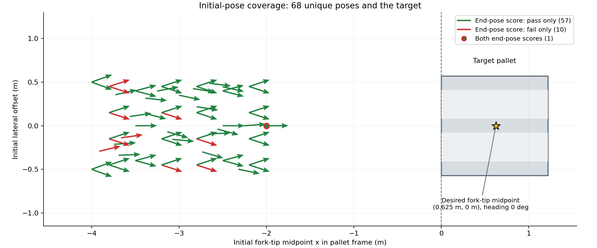
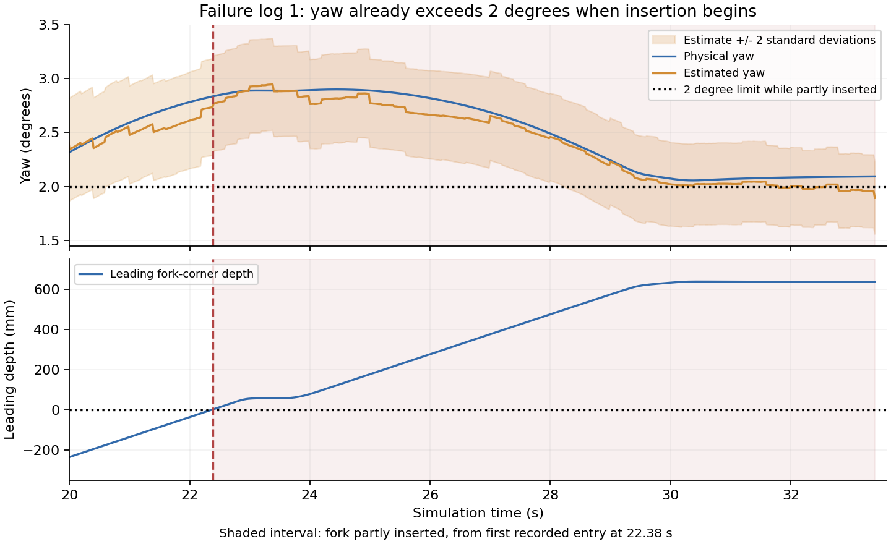
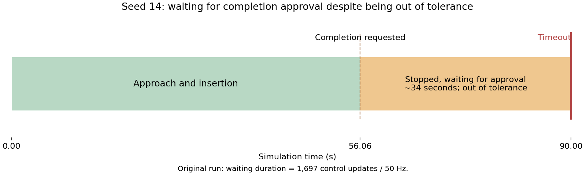
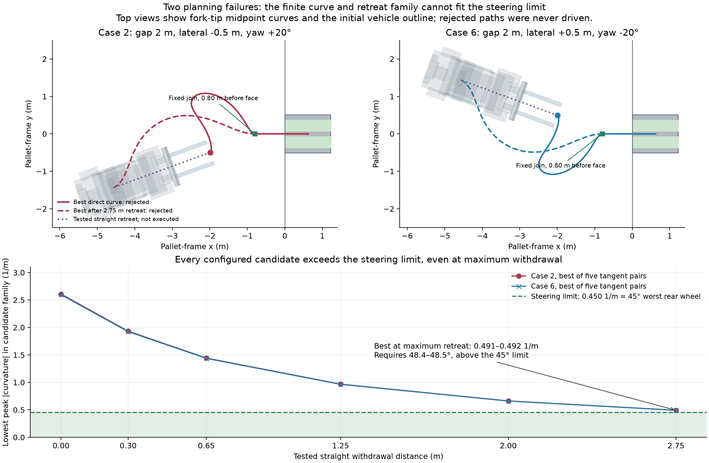
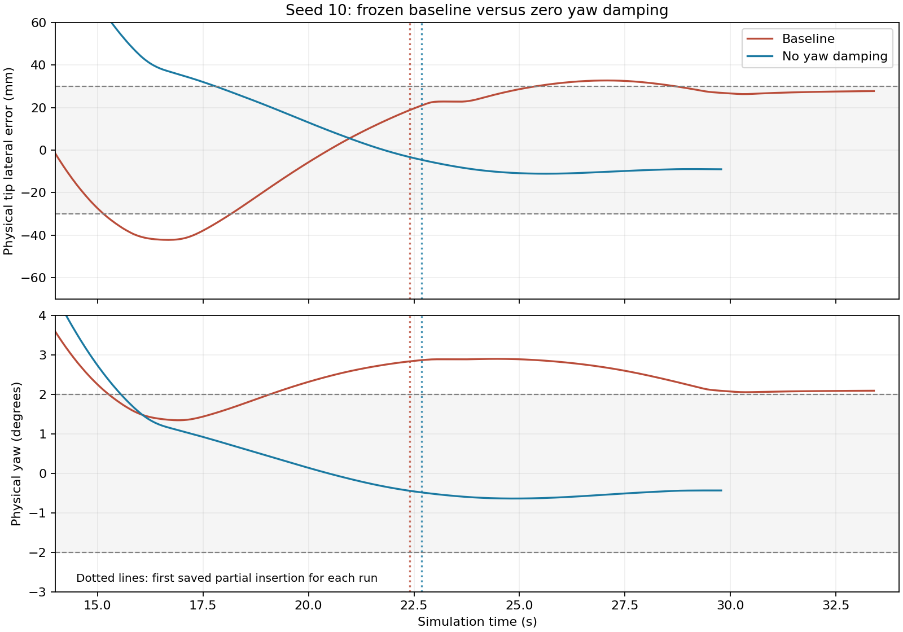

# Pallet-engagement robustness study

2026-11-22. The original three batches use the same archived controller and required widened pallet. The yaw-damping follow-up below uses a separately archived candidate.

## Initial-condition coverage

One arrow per unique initial pose: 68 arrows at their true positions. Colors show the recorded end-pose score: green passes, red fails, and a red-ringed green start has both outcomes. These colors do not yet assess yaw throughout insertion. The star marks the target.

## Results

**129/130 configurations have passed under at least one controller version.** This combines recorded final-pose passes across versions; it is not an overall success rate for the zero-yaw-damping controller or validation of yaw throughout insertion.

Recorded end-pose passes: **116/130**, with zero contact: 32/34 originally, 60/64 in the seed/disturbance extension, and 24/32 in the distinct-pose batch. Of all attempts, 109 passed within 60 s; 28 used recovery.

These scores check yaw at the end. They must be re-evaluated against the required 2° limit throughout partial insertion.

The first extension passed 22/24 single-disturbance cases, 14/16 combined cases, 20/20 runs at ten new poses, and 4/4 nominal controls. The last batch tested 32 additional new poses once each, without combined disturbances.

A separate [centered realtime run](docs/robustness/evidence/realtime-outcome.json) passed in **23.38 s**, with 24 missed control deadlines. All study batches used deterministic mode, which pauses physics during computation.

### Original two failures

**Seed 10:** Already exceeded 2° at entry. Stopped at 33.40 s with 610.7 mm insertion and +27.8 mm lateral error, but yaw was +2.094°, exceeding the 2° limit. The estimate reported +1.894°, so the supervisor accepted completion while the physical evaluator rejected it.

**Seed 14:** Stopped tracking at 56.06 s, then waited until the 90 s timeout. Final insertion was 600.6 mm, lateral error -44.9 mm, and yaw -3.701°. The supervisor rejected completion, but the controller kept requesting it instead of correcting or recovering.

Both had tracking error before insertion and neither used its recovery retry. See the [archived attempts](docs/attempts/README.md).

**Seed/disturbance extension failures:** Seed 28 timed out with 30% dropout, 50% dropout, noise plus dropout, and dropout plus a 2 s outage. All four settled beyond 600 mm insertion, but yaw remained outside tolerance, from -2.106° to -2.737°, with repeated completion-pending decisions. The nominal seed-28 control passed.

**Distinct-pose failures:** Eight of the 32 new poses failed: three timeouts and five `terminal_pose_error` outcomes. At 2.8–3.2 m, failures exceeded the yaw limit; at 3.8 m, they exceeded the lateral limit. All reached insertion depth without contact.

**Zero-yaw-damping follow-up:** 13/14 previously failed cases now pass the final-pose evaluator, with zero contact. This combines 13 new runs and the reused seed-10 candidate. Of the new runs, 12 pass both final criteria and insertion yaw checked every 2 ms. See failure 4 below. The original 116/130 score is unchanged.

## Animations

**Success, seed 7:** Direct engagement in 28.48 s.

**Failure, seed 10:** Contact-free insertion, but yaw exceeds 2° from entry onward.

Both play at 2x speed. [All four animations](docs/attempts/README.md) are committed in `0fcfe20`.

## Failure log

### 1. Entry is allowed with excessive yaw

At the first recorded fork penetration, 22.38 s, seed 10's true yaw was 2.84° and its estimate was 2.74°. Yaw later reached 2.90° while inserted. This is already a failure: the 2° limit applies whenever a fork is partly inside.

Comparing fork penetration, true yaw, and estimated yaw exposed the cause: the tested controller allowed collision-clear entry without enforcing the insertion yaw limit. The final estimate passing while true yaw failed was an additional acceptance error.

### 2. Rejected completion leaves the controller stopped

Seed 14's controller waited about 34 seconds for completion approval despite being out of tolerance. It requested completion after reaching the forward-position threshold, without checking lateral or yaw error. The supervisor rejected the pose, but the controller neither corrected it nor recovered, repeating the request until timeout.

Completion was requested at 56.06 s; the controller then waited until the 90 s timeout.

Current fix: completion requires depth, lateral, yaw, and clearance checks. The failed seed-14 rerun stopped at 56.47 s, settled without contact, with zero completion requests. It reports failure rather than correcting the pose. The study results above retain the original behavior.

### 3. The earlier curve family exceeds the steering limit

Historical cases 2 and 6 start 2 m away with mirrored lateral offsets of ±0.5 m and headings of ∓20°. Both fail planning without driving the rejected curves.

Reconstructing the planning context and checking all five tangent pairs, including withdrawals up to 2.75 m, isolated the cause. Even the best candidates required 48.4°–48.5° rear-wheel steering, above the 45° limit. Retreat clearance was positive.

These failures belong to the earlier quintic planner and are excluded from the study totals. They show a limited candidate family, not proof that no feasible maneuver exists.

### 4. Yaw damping worsens seed 10's alignment

Disabling the yaw-damping term makes seed 10 pass with the same initial planned path, seed, sensing, delay, and acceptance settings. Final lateral error improves from +27.78 mm to -8.98 mm, and final yaw improves from +2.094° to -0.432°. The candidate finishes at 29.78 s, settled and contact-free.

The maximum saved yaw magnitude during partial insertion falls from 2.900° to 0.636°. Dotted lines mark first saved penetration. This identifies the yaw-damping term as a contributor to this case's tracking failure. One case does not establish an improvement across the full operating range.

Yaw damping is now zero in the current controller. The failure-only follow-up uses the original frozen implementation with that single setting changed, excluding the separate completion-handling fix. Seed 10's successful candidate run is reused. Original study scores remain unchanged. [Per-case measurements](docs/robustness/evidence/no-yaw-damping-failed-cases.csv).

The follow-up resolves all eight distinct-pose failures, original seed 14, and three of four dropout failures. The remaining 50%-dropout seed-28 case times out with -41.05 mm lateral error. Its insertion yaw reaches 2.059°, so it also violates the throughout-insertion requirement. All 13 new runs have a physical yaw audit at every 2 ms physics update. Reused seed 10 has no observed violation in its 40 ms saved states. [Results and audit limits](docs/robustness/evidence/no-yaw-damping-failed-cases.json).

## Test conditions

All runs used a 90 s budget and fixed 2.5 m recovery withdrawal. The extension uses the original study's saved implementation, preserving comparability. Previously successful simulations were not rerun.

The original 34 cases covered random and far starts, sensing noise, outages, and delay. The first 64 added cases were:

- **24 single-disturbance runs:** Eight settings repeated with seeds 26–28. Together with original seed 8, each setting now has four seeds. Settings cover dropout 0.3/0.5, noise scale 2, 1–2 s outages, and 230/270 ms delay.
- **16 combined runs:** Four profiles, each with seeds 26–29: noise scale 2 plus dropout 0.3; noise scale 2 plus 270 ms delay; dropout 0.3 plus a 2 s outage; and an offset start plus noise scale 2 and 230 ms delay. The offset start is 3 m away, +0.35 m lateral, and -12° heading.
- **20 new-pose runs:** Ten previously untested poses, each with seeds 30 and 31 and nominal sensing/delay. At 2.5 and 3.5 m, test a centered start and all ±0.4 m lateral/±15° heading combinations.
- **4 controls:** Centered starts with nominal sensing/delay, seeds 26–29.

The final **32 distinct-pose runs** cover all combinations of distances 2.2/2.8/3.2/3.8 m, lateral offsets ±0.15/±0.45 m, and headings ±18°. Each pose was checked against the full archive and run once, with nominal sensing/delay and fixed seed 32.

Yaw must stay within 2° whenever any fork is partly inside. Completion also requires 600 mm insertion, lateral error below 30 mm, both forks inside the pockets, zero contact, and 200 ms settled below 0.01 m/s and 0.01 rad/s.

## Limitations

- **Task:** Fixed fork height and a stationary pallet on a flat, empty floor. Lifting, loads, slopes, and obstacles are untested.
- **Perception:** Synthetic pose observations, not camera detections. Occlusion and incorrect pocket association are untested.
- **Dynamics:** Steering, braking, and slip have not been identified on hardware.
- **Realtime:** Centered runs passed; deadline guarantees and broader realtime coverage remain unvalidated.
- **Coverage:** The repeated settings have four seeds each. Other interactions and realtime disturbance coverage remain untested.
- **Known failures:** Insertion yaw enforcement, final-pose acceptance, and recovery after partial insertion remain unresolved in the tested version. Better lateral-controller tuning could reduce alignment failures.
